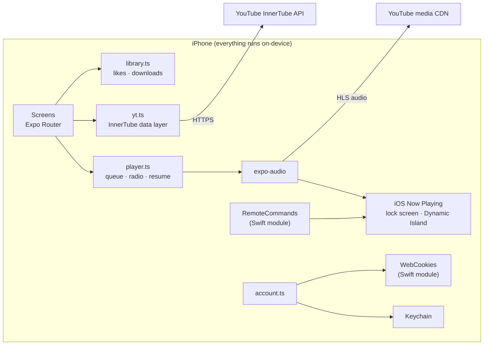

<p align="center">
  
</p>

<h1 align="center">Melo</h1>

<p align="center">
  <b>An ad-free YouTube Music player for iPhone, built with React Native and Expo.</b><br/>
  Streams, searches and downloads music straight from YouTube Music, entirely on the device: no backend, no API key, no cost.
</p>

<p align="center">
  
  
  
  
  
  
</p>

> [!IMPORTANT]
> **Built for experimentation, learning and study, not as a product.** I made Melo to study how React Native really works on iOS and to understand it through a real, non-trivial app, not tutorials. It is not on the App Store, isn't meant for distribution, and isn't affiliated with or endorsed by YouTube or Google. See [Why I built this](#why-i-built-this) and the [disclaimer](#disclaimer).

## Why I built this

Melo is an **experiment and a learning project**. I wanted to go beyond to-do apps and understand the dynamics of React Native by building something that pushes on every layer at once:

- **How React Native works under the hood:** the JavaScript thread, the Hermes engine, and how JS talks to native iOS code through Expo Modules.
- **Writing native code when JavaScript isn't enough:** two small Swift modules for lock-screen controls and WebView cookies, and learning where the JS/native boundary should sit.
- **State and performance on a phone:** a lightweight store with `useSyncExternalStore`, dropping stale async work, prefetching, and keeping lists smooth with infinite scroll.
- **How iOS treats audio apps:** audio sessions, background modes, Now Playing, remote commands and the Dynamic Island.
- **How streaming actually works:** HLS playlists, AAC segments, and what a real app has to handle when an upstream service changes.
- **The full native toolchain:** Expo prebuild, CocoaPods, Xcode signing, and installing on a real device with a free Apple ID.

Every feature was a way to study one of these topics. The [engineering highlights](#engineering-highlights) section lists what I ran into and learned.

---

## Screenshots

<table>
  <tr>
    <td align="center"><br/><b>Home</b><br/><sub>Listen again, quick picks and personalised shelves</sub></td>
    <td align="center"><br/><b>Search</b><br/><sub>Live suggestions, filters and infinite scroll</sub></td>
    <td align="center"><br/><b>Now Playing</b><br/><sub>Seek, shuffle, repeat, like, download, lyrics and queue</sub></td>
  </tr>
  <tr>
    <td align="center"><br/><b>Lock screen</b><br/><sub>Artwork, seek bar and next/previous track</sub></td>
    <td align="center"><br/><b>Sign in</b><br/><sub>Google account or TV-code login</sub></td>
    <td align="center" valign="middle"><br/><b>Dynamic Island</b><br/><sub>Live playback controls from any app</sub></td>
  </tr>
</table>

---

## Features

**Listening**
- Ad-free streaming of any song on YouTube Music, in high-quality AAC audio
- Background playback that keeps going with the screen locked or in other apps
- Lock screen, Control Center and **Dynamic Island** controls with a working seek bar and next/previous track
- Endless "radio": the queue tops itself up with similar songs as it runs low
- Shuffle, repeat, play next, add to queue and lyrics
- **Offline downloads**: save a song once and play it with no connection
- **Resume where you left off**: the queue and position are restored when you reopen the app

**Discovery**
- Personalised home feed (Listen again, Quick picks, mixes) from YouTube's own recommendations
- Search with live suggestions, filters (Songs, Artists, Albums, Playlists) and infinite scroll
- Album, artist and playlist pages

**Your account (optional)**
- **Sign in with Google** for your own YouTube Music home, history, playlists and likes
- **TV-code sign-in** as an alternative, where you approve on google.com/device and your password never enters the app
- Likes sync both ways: liking in Melo likes on YouTube, and your YouTube likes appear in Melo
- Sign-in data is stored only in the iPhone **Keychain**

**Privacy**
- No backend, no analytics, no tracking SDKs. The app talks to YouTube and nothing else.

---

## Tech stack

| Layer | Technology |
|---|---|
| App framework | **React Native 0.88** with **Expo SDK 58**, Hermes engine |
| Language | **TypeScript** (app), **Swift** (native modules), Kotlin (Android cookie module) |
| Navigation | **Expo Router**: file-based routes, tabs and modal screens |
| Data source | [`youtubei.js`](https://github.com/LuanRT/YouTube.js), a client for YouTube's internal InnerTube API |
| Audio | `expo-audio` with iOS Now Playing / remote command integration |
| Storage | `expo-file-system` (library + downloads), `expo-secure-store` (Keychain) |
| UI | `expo-image`, `expo-blur`, `expo-linear-gradient`, `expo-haptics`, custom components |
| Build and signing | Xcode 26, CocoaPods, Expo prebuild (Continuous Native Generation) |

---

## Architecture



**How a song plays**
1. `yt.ts` asks InnerTube for the track's streaming data, using the client profile YouTube serves to visionOS.
2. That returns an **audio-only HLS playlist**. Melo picks the highest-quality AAC variant.
3. `expo-audio` streams it with native iOS playback. YouTube's ad system lives in its own player, which Melo never loads, so there are no ads.
4. `player.ts` publishes metadata to iOS Now Playing, and the Swift `RemoteCommands` module routes lock-screen and Dynamic Island taps back to the queue.

---

## Engineering highlights

Problems solved while building Melo:

- **Stream URLs breaking after ~1 MB.** YouTube now enforces proof-of-origin tokens on its iOS, mobile-web and Music clients, so direct audio URLs fail partway through a song. I traced the failure, then switched to the visionOS client profile, which returns a standards-based HLS stream that iOS plays natively. That made playback reliable without running a token generator.
- **Lock screen showing "±10 s" instead of next/previous.** `expo-audio`'s single-file player only registers skip-interval commands. Rather than patching a dependency, I wrote a small **native Expo module in Swift** that re-registers `MPRemoteCommandCenter` next/previous handlers and forwards them to JavaScript as events.
- **"LIVE" badge and no seek bar.** HLS streams report an indefinite duration while loading, so iOS treated songs as live broadcasts. Forcing `isLiveStream: false` in the Now Playing metadata restored the scrubber.
- **Offline downloads from a segmented stream.** Downloads fetch every HLS segment, strip the per-segment ID3 tags and join the raw ADTS AAC frames into one playable `.aac` file, with progress reporting.
- **Running a Node-oriented library on Hermes.** `youtubei.js` expects browser and Node APIs, so a polyfill layer (URL, streams, EventTarget, base64 and secure random through `expo-crypto`) loads before the app starts.
- **Two sign-in methods.** TV device-flow tokens are rejected by YouTube Music's account endpoints, so I added Google login in a WebView. A second native module reads the session cookies from `WKWebsiteDataStore`. Credentials are split into chunks to fit Keychain item limits.
- **Responsive queue handling.** Each track load carries a token so that stale network responses are dropped when the user skips quickly, and the next track's URL is prefetched.

---

## Project structure

```
src/
  app/                    Screens (Expo Router)
    (tabs)/               Home, Search, Library
    player.tsx            Full-screen player (modal)
    account.tsx           Account and sign-in options
    google-login.tsx      Google sign-in WebView
    album/ artist/ playlist/ history.tsx
  lib/
    yt.ts                 YouTube Music data layer and audio resolution
    player.ts             Playback engine: queue, radio, lock screen, session resume
    library.ts            Likes, recents, offline downloads
    account.ts            Google / TV sign-in and Keychain storage
    polyfills.ts          Web APIs needed by youtubei.js on Hermes
    store.ts              Tiny external store with useSyncExternalStore
  ui/                     Theme, shared components, mini player
modules/
  remote-commands/        Swift: next/previous on lock screen and Dynamic Island
  web-cookies/            Swift + Kotlin: read WebView cookies for Google sign-in
scripts/make_icon.py      Generates the app icon
```

---

## How to install Melo on your iPhone

Melo isn't on the App Store, so you build it on a Mac and install it onto your own iPhone with a **free Apple ID**. This takes about 30–45 minutes the first time, mostly downloads and the first build. You don't need a paid developer account.

### What you need

| | Requirement |
|---|---|
| 💻 | A **Mac** with **Xcode 26.4 or newer** (free on the Mac App Store, about 10 GB) |
| 📱 | An **iPhone on iOS 16.4 or newer** and a USB cable |
| 🍎 | A free **Apple ID** (the one you already use is fine) |
| 🟩 | **Node.js** LTS from [nodejs.org](https://nodejs.org) |
| 🧰 | **Git** (macOS offers to install it the first time you run `git`) |

---

### Step 1: Install Xcode and set it up

1. Install **Xcode** from the Mac App Store and open it once. Let it finish installing its extra components.
2. When it asks which platforms you want, make sure **iOS** is selected.
3. In Xcode, go to **Xcode → Settings → Accounts**, click **+**, choose **Apple ID** and sign in. Xcode creates a free "Personal Team" for you.

### Step 2: Download the code

Open **Terminal** and run:

```bash
git clone https://github.com/nithin261829/melo.git
cd melo
npm install
```

### Step 3: Make the app ID yours

Every app needs a unique ID, and Apple won't let two people sign the same one. Open `app.json` and change two lines under `"ios"`:

```jsonc
"bundleIdentifier": "com.yourname.melo",   // anything unique, e.g. com.priya.melo
"appleTeamId": "YOUR_TEAM_ID"               // or delete this line and pick the team in Xcode (see Troubleshooting)
```

To find your Team ID, sign in at [developer.apple.com/account](https://developer.apple.com/account) and look under **Membership details**. Free accounts have one too.

### Step 4: Get the iPhone ready

1. Plug the iPhone into the Mac and unlock it. When it asks **"Trust This Computer?"**, tap **Trust** and enter your passcode.
2. Turn on **Developer Mode**: on the iPhone, go to **Settings → Privacy & Security → Developer Mode**, switch it on and let the phone restart. Then confirm with **Turn On**.
   > Don't see Developer Mode? Open Xcode with the phone plugged in, go to **Window → Devices and Simulators**, and the option will appear on the phone.

### Step 5: Build and install

With the iPhone plugged in and **unlocked**, run this in the `melo` folder:

```bash
LANG=en_US.UTF-8 LC_ALL=en_US.UTF-8 npx expo run:ios --device --configuration Release
```

- When asked, **pick your iPhone** from the list.
- The first build takes **10–20 minutes**. Later builds are faster.
- `Release` puts all the app's code inside the app, so it runs on its own afterwards. You don't need the Mac or Terminal running.

### Step 6: Trust the app on the iPhone

The first time, iOS blocks apps from personal developers until you allow them:

1. On the iPhone, open **Settings → General → VPN & Device Management**.
2. Under **Developer App**, tap your Apple ID, then tap **Trust**.
3. Open **Melo** from your home screen. 🎉

### Step 7: Keep it working (every 7 days)

With a free Apple ID, iOS lets self-installed apps run for **7 days**. After that, Melo won't open until you renew it. Your downloads and likes stay on the phone either way.

| Option | How | Cost |
|---|---|---|
| **Rebuild from the Mac** | Plug in the phone and run the Step 5 command again | Free |
| **SideStore** | Refresh from the phone over Wi-Fi, no Mac needed ([docs.sidestore.io](https://docs.sidestore.io)) | Free |
| **Paid Apple Developer account** | The app lasts 1 year per install | $99/year |

---

### Troubleshooting

| Problem | Fix |
|---|---|
| `Unicode Normalization not appropriate for ASCII-8BIT` during `pod install` | You left out `LANG=en_US.UTF-8 LC_ALL=en_US.UTF-8` at the start of the command. Run it exactly as shown in Step 5. |
| **"Signing requires a development team"** or a provisioning error | Open `ios/Melo.xcworkspace` in Xcode, select the **Melo** target → **Signing & Capabilities**, choose your **Personal Team**, then run Step 5 again. |
| **"Failed to register bundle identifier"** | Someone already uses that ID. Change `bundleIdentifier` in `app.json` to something more unique (Step 3). |
| **"Untrusted Developer"** when opening Melo | Do Step 6. |
| **"Unable to launch … profile has not been explicitly trusted"** or the phone was locked | The install still worked. Unlock the phone and open Melo yourself (after Step 6). |
| The app stopped opening after a week | The 7-day limit. See Step 7. |
| Xcode says your iOS version isn't supported | Update Xcode, or open **Xcode → Settings → Components** and download the matching iOS platform. |

### For developers

```bash
npx expo run:ios        # run in the iOS Simulator with live reload
npx tsc --noEmit        # type-check
npx expo lint           # lint
```

---

## Disclaimer

**This project exists only for experimentation, learning and studying React Native.**

- I built Melo to study the dynamics of React Native and understand native iOS integration (Swift), audio streaming and app architecture through hands-on experimentation. It is not a commercial product and is not distributed through any app store.
- Melo is not affiliated with, endorsed by or connected to YouTube or Google. "YouTube" and "YouTube Music" are trademarks of Google LLC.
- Accessing or downloading YouTube content outside YouTube's official apps goes against YouTube's Terms of Service. Don't use this project to redistribute content or for any commercial purpose.
- All music, artwork and metadata belong to their respective owners. Album art in the screenshots is shown only to demonstrate the interface.
- The code is provided as-is, with no warranty. You are responsible for how you use it.

---

## License

The source code is released under the [MIT License](LICENSE). That covers the code and the app icon in this repository only. It grants no rights to YouTube content, music or artwork, which belong to their respective owners (see the [disclaimer](#disclaimer)).
