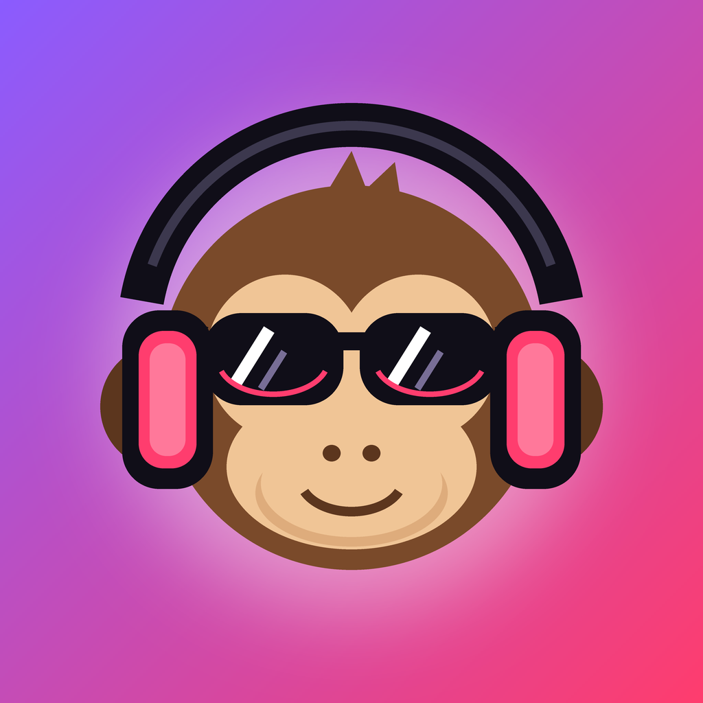
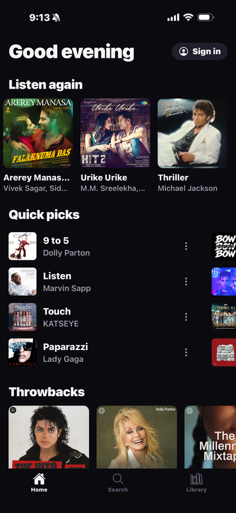
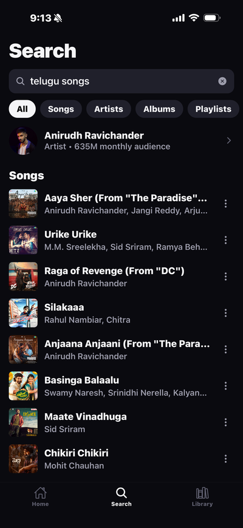
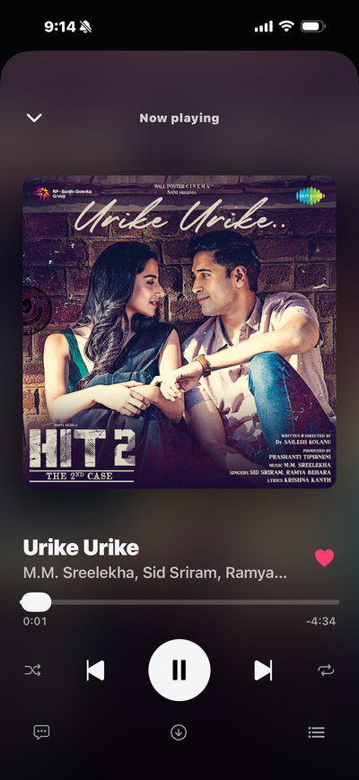
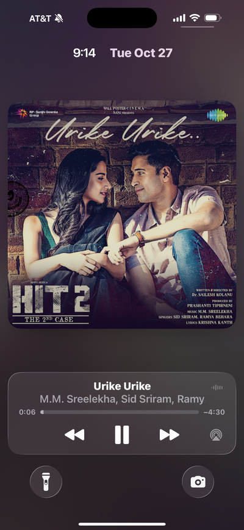
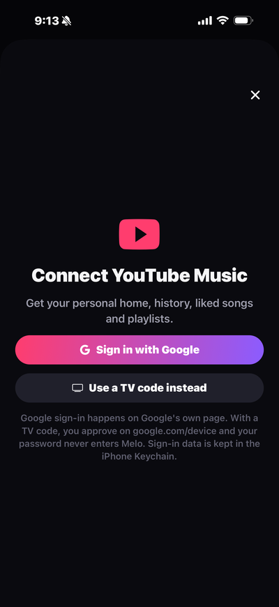
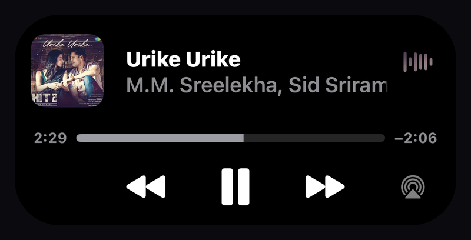

<p align="center"></p>

# Melo

An ad-free YouTube Music player for iPhone, with an AI DJ ([Melodi AI](https://github.com/nithin261829/melodi-ai)) that builds a mix for your moment.

React Native · Expo · TypeScript · Swift · MIT

> A learning project to understand React Native and native iOS by building a real app. Not on the App Store, and not affiliated with YouTube or Google.

<table>
  <tr>
    <td align="center"><br/><sub>Home</sub></td>
    <td align="center"><br/><sub>Search</sub></td>
    <td align="center"><br/><sub>Now playing</sub></td>
  </tr>
  <tr>
    <td align="center"><br/><sub>Lock screen</sub></td>
    <td align="center"><br/><sub>Sign in</sub></td>
    <td align="center"><br/><sub>Dynamic Island</sub></td>
  </tr>
</table>

## Why I built it

I wanted to understand React Native properly, not through to-do apps but by building something that touches every layer at once: the JavaScript thread, native Swift code, audio sessions, background modes, streaming and real-device installs. A music player I'd use every day was the right size for that. Later I added Melodi AI to learn how to put an LLM into a real feature without letting it make things up.

## Features

- Ad-free streaming, background play, offline downloads
- Lock screen and Dynamic Island controls with next/previous and a seek bar
- Search with filters and infinite scroll; albums, artists and playlists
- Sign in with Google or a TV code for your own home feed, history and likes
- **Melodi AI tab:** a mix for your time, weather, activity and mood, with a reason for each song

## How it works

```text
Melo (iPhone)
  ├─ youtubei.js → YouTube Music: search, home, playlists, audio
  ├─ expo-audio → playback, lock screen, Dynamic Island
  ├─ Swift modules → next/previous buttons, Google sign-in cookies
  └─ Melodi AI client → sends moment labels (no GPS), gets a mix back
```

## How it's built

- **Audio that doesn't stop after 1 MB.** YouTube now cuts off direct audio links for most clients partway through a song. I traced it, then switched to the client profile YouTube serves to visionOS, which returns an audio-only HLS stream that iOS plays natively. No ads, because YouTube's ads live in its own player.
- **Lock screen buttons.** `expo-audio` only showed ±10-second skips. I wrote a small Swift module (`modules/remote-commands`) that registers next/previous with iOS and sends the taps to JavaScript, instead of patching the library.
- **Seek bar instead of "LIVE".** HLS reports an unknown length while loading, so iOS showed songs as live radio. Marking them as not live brought the scrubber back.
- **Offline downloads.** A download fetches every HLS segment, strips the per-segment ID3 tags and joins the AAC frames into one playable file.
- **Google sign-in.** A second Swift module reads the login cookies from the WebView, so the app gets your own home feed, history and likes. Credentials go in the iPhone Keychain, split into chunks to fit its size limit.
- **A Node library on Hermes.** `youtubei.js` expects browser and Node APIs, so a small polyfill layer (URL, streams, EventTarget, base64, secure random) loads before anything else.
- **Fast skipping.** Each track load carries a token, so a slow response from a song you already skipped is ignored, and the next song's stream is fetched early.
- **Picks up where you left off.** The queue and position are saved, so reopening the app resumes the same song.
- **Melodi AI on the phone.** `src/lib/context.ts` turns location into labels on the device (city, weather, walking or driving, sunset). Only those labels go to the server, never GPS, and the last mix is reused for 30 minutes so opening the app doesn't spend API credit every time.

## Install on your iPhone

Needs a Mac with Xcode 26.4+, Node.js and a free Apple ID.

```bash
git clone https://github.com/nithin261829/melo.git && cd melo
npm install
LANG=en_US.UTF-8 npx expo run:ios --device --configuration Release
```

1. Change `bundleIdentifier` and `appleTeamId` in `app.json` to your own first.
2. On the iPhone, turn on **Developer Mode**, then trust your Apple ID in **Settings → General → VPN & Device Management**.
3. Free Apple IDs expire after 7 days. Run the build again to renew.

For Melodi AI, run the [Melodi AI server](https://github.com/nithin261829/melodi-ai) and set `EXPO_PUBLIC_MELODI_URL` in `.env` (see `.env.example`).

## License

[MIT](LICENSE), for the code only. Streaming from YouTube outside its official apps goes against YouTube's Terms of Service, so this is for learning only. Music and artwork belong to their owners.
